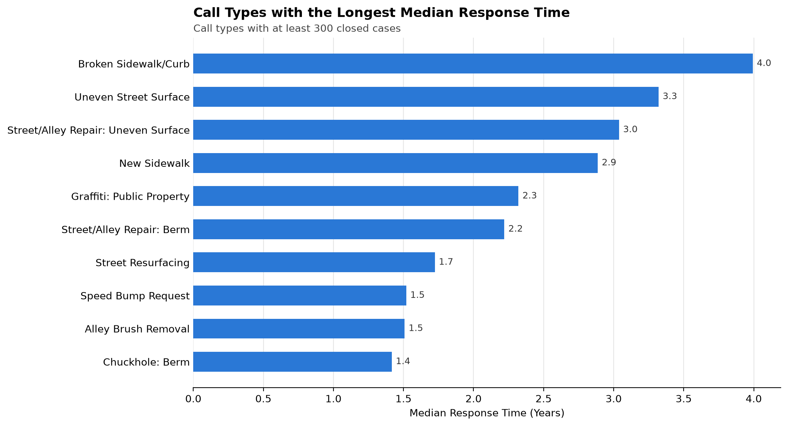

# Indianapolis 311: Response Times, Seasonality and a Simple Forecast

How long Indianapolis residents wait for city service requests to be resolved, which problems follow the seasons, and whether a plain historical average can tell the city where demand will land next quarter.



## Three findings

1. **Most cases close in days, but infrastructure repairs take years.** The median closed case takes 3.8 days. Broken sidewalks and curbs take a median of 1,458 days (about 4 years), and uneven street surfaces take 1,213 days (about 3.3 years). Of the 113 call types with at least 300 closed cases, the 10 slowest all wait more than 500 days.
2. **Chuckholes and weeds follow the calendar.** Street chuckhole (pothole) reports run at 2.06 times an average month in January through March and drop to 0.25 in October through December. Weed complaints are the mirror image: 2.18 times an average month in April through June and almost none in winter.
3. **A simple average picks the right districts but misses the counts.** Averaging Q1 cases from 2016 to 2021 correctly named 11 of the 15 busiest council district and call type combinations for Q1 2022 (73% precision), but the projected counts were off by 19.7%. Leaving out February, when a major winter storm hit, didn't help (21.4%), so the storm isn't what threw the counts off.

## The three questions

| | Question | Script |
|---|---|---|
| Q1 | Which call types and ZIP codes wait longest for a case to be closed? | [`src/q1_response_times.py`](src/q1_response_times.py) |
| Q2 | Which call types are seasonal, and how strongly? | [`src/q2_seasonality.py`](src/q2_seasonality.py) |
| Q3 | Can a historical average predict where Q1 demand will land? | [`src/q3_forecast.py`](src/q3_forecast.py) |

Supporting work lives in [`src/supporting/`](src/supporting/): exploratory charts (time to close, closures per month, chuckholes per year) and a council district profile.

## Quick start

You'll need Python 3.13. The download pulls about 1.2 million rows (230 MB) from the city's open data service and takes a while, but it only runs once. After that, the file is reused.

```bash
python -m venv .venv
source .venv/bin/activate
pip install -r requirements.txt
python src/download_data.py   # saves data/raw/mac_legacy_service_cases.csv
python src/run_all.py         # writes figures/, results/ and data/processed/
```

Want to look around before downloading anything? [`data/sample/mac_cases_sample.csv`](data/sample/mac_cases_sample.csv) has the first 1,000 rows.

## What's in the repo

```
src/
  config.py              thresholds, dates and paths, each with the reasoning behind it
  download_data.py       pages through the ArcGIS service into data/raw/
  clean.py               dates, cutoff, closed/open split, text cleanup, cleaning log
  q1_response_times.py   Q1
  q2_seasonality.py      Q2
  q3_forecast.py         Q3
  labels.py, plotting.py shared chart labels and styling
  run_all.py             runs everything in order
  supporting/            exploratory charts and the district profile
figures/                 every chart and table image
results/                 one CSV per analysis table, plus cleaning_log.csv
reports/                 the full PDF report
```

## Data

The data is the City of Indianapolis [Mayor's Action Center Legacy Service Cases](https://hub.arcgis.com/datasets/d2fda038f9c1448a985fb55647593499_3) dataset, which covers requests made through the city's 311 line, website and RequestIndy app. Each row is one case: what was reported, where, when it was opened and when it was closed. The [data README](data/README.md) covers the source, the download date and a column-by-column data dictionary.

### What was excluded, and why

Every filtering step is printed when the pipeline runs and saved to [`results/cleaning_log.csv`](results/cleaning_log.csv).

| Step | Rows dropped | Why |
|---|---|---|
| Created on or after August 1, 2022 | 283,728 of 1,220,121 (23.3%) | The city changed case systems that month. Later cases have no subcategory or council district and use a different set of keywords, so they can't be compared with earlier ones. |
| Closed cases missing a created or closed date | 6 | A response time needs both dates. |
| Open cases missing a created date | 1 | Seasonality is based on when a case was created. |
| Missing council district (forecast and district tables only) | 19,956 of 936,386 (2.1%) | A case without a district can't be assigned to one. Most of these are from April and May 2019. |

All dates are converted from UTC to Indianapolis time, so a case reported on a winter evening counts toward the day, quarter and year the resident actually experienced.

## Limitations

- **Closed date isn't the same as fixed date.** A case can be closed when it's merged, referred to another agency or scheduled, so response time measures how long a case stayed open in the system, not how long the problem lasted.
- **Older open cases have no response time.** Response times only cover closed cases. Problems still open at the end of the data aren't counted, which makes the slowest call types look faster than they are.
- **The forecast is a baseline, not a model.** It averages six Q1s and doesn't account for trends, weather or changes in how cases are reported. It is there to show the average number of each case type occurs per season.
- **Data ends at the August 2022 system change.** Anything after that would need the city's newer dataset and a mapping between the old and new keywords. Data exists from 2023-2025; however most of the data from 2023 was lost, so it would result in information from that year being underrepresented. Because of this, data was cut off at August of 2022, before major data loss occurred from the city switching systems.

## Full report

The written report with methods and discussion can be found here: [`reports/`](reports/).

## About

Made by Kendall Troy. Find me on LinkedIn: www.linkedin.com/in/kendall-troy.
